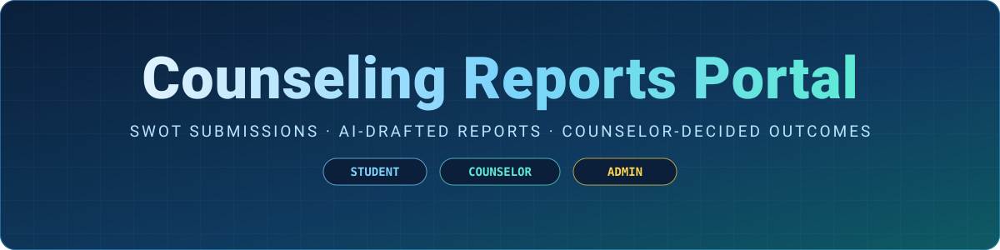
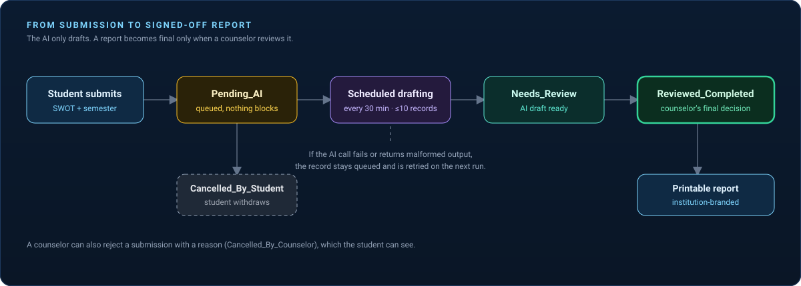
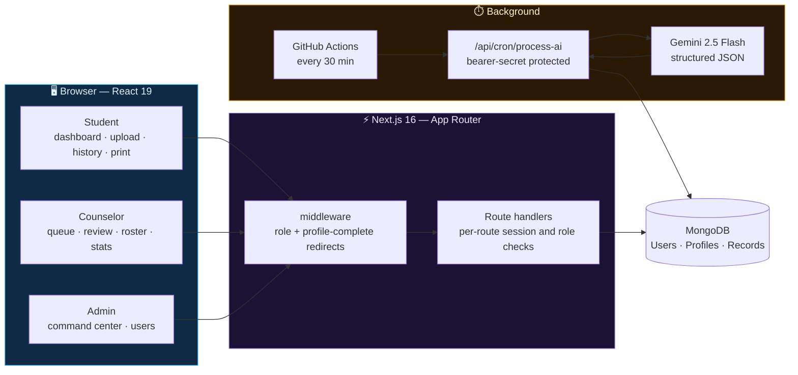
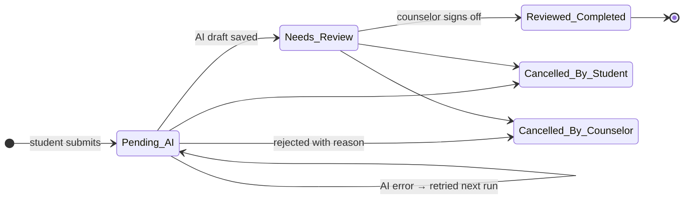
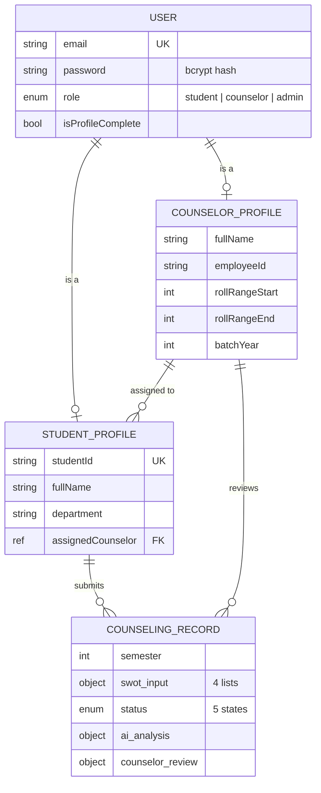

<div align="center">



<br/>

[](#-tech-stack)
[](#-tech-stack)
[](#-data-model)
[-7c3aed?style=flat-square)](#-access--security-model)
[](#-ai-assisted-drafting)
[](#-background-processing)
[](#-responsible-use)

**Students submit a SWOT reflection. An AI drafts the analysis in the background. A counselor reviews, edits and signs off — and only then does it become a report.**

</div>

---

## What is this?

The Counseling Reports Portal is a **role-based web app for running a university counselling programme at scale**. Instead of collecting reflections by hand and writing every report from scratch, counselors work from a prepared queue: each student's SWOT (Strengths, Weaknesses, Opportunities, Threats) is analysed automatically into a **draft** that includes a profile summary, a risk indication, career insights and a suggested action plan — which the counselor then reviews, adjusts and finalises.

1. **Students** register, pick their counselor, submit a SWOT, track its status, withdraw it if needed, and print the finished report.
2. **Counselors** get a roster of their students, a live action queue, a side-by-side review screen with the AI draft, and bulk tools for clearing the queue.
3. **Admins** manage accounts and see programme-wide counts.
4. **AI drafting runs in the background** on a schedule, so submitting never waits on a model call.
5. **A human always makes the final decision.** The AI draft is a starting point, never the outcome.

<br/>

<div align="center">

<sub>Animated in a browser (GitHub renders raw SVG natively) — packets travel from submission to a signed-off report.</sub>
</div>

---

<!--ARCHIVE_STATS_START-->
<!-- auto-generated by archive_stats.py — do not edit this block manually -->

### 📦 Project Snapshot &nbsp;·&nbsp; <sub>refreshed 25 Nov 2026, 11:37 PM IST</sub>

   

| 📅 Created | 🔄 Last Push | 💬 Total Commits | ⭐ Stars | 🍴 Forks | 📜 License |
|---|---|---|---|---|---|
| 2026-03-19 | 2026-11-25 | 35 | 0 | 1 | None |

**Live Demo:** [sp2736.github.io/counseling-reports-portal](https://sp2736.github.io/counseling-reports-portal) &nbsp; <sub>last deployed 2026-11-13</sub>

**Languages:** `TypeScript` 99.5%  `JavaScript` 0.3%  `CSS` 0.3%

**Top Contributors:** [@Sp2736](https://github.com/Sp2736) `30` · [@jalisa2106](https://github.com/jalisa2106) `6`

<!--ARCHIVE_STATS_END-->

---

## Table of Contents

- [Why This Exists](#why-this-exists)
- [Architecture at a Glance](#-architecture-at-a-glance)
- [Roles & Screens](#-roles--screens)
- [Report Lifecycle](#-report-lifecycle)
- [AI-Assisted Drafting](#-ai-assisted-drafting)
- [Background Processing](#-background-processing)
- [Responsible Use](#-responsible-use)
- [Access & Security Model](#-access--security-model)
- [Data Model](#-data-model)
- [API Surface](#-api-surface)
- [Tech Stack](#-tech-stack)
- [Getting Started](#-getting-started)
- [Configuration Reference](#-configuration-reference)
- [Project Layout](#-project-layout)
- [Roadmap](#-roadmap)

---

## Why This Exists

Counselling programmes with hundreds of students hit the same wall: every student writes a reflection, every reflection needs a thoughtful response, and the counselor's limited hours go into *reading and typing* instead of *talking to students*. This project is built around three principles:

- **Spend human time on judgement, not drafting.** Pre-structured AI analysis gets a counselor to the review stage immediately.
- **Never block the student.** Submission is a fast database write; analysis happens later, off the request path.
- **Keep a person accountable.** Every report has a counselor review step with editable risk level and action plan, and the final record is the counselor's.

---

## 🏗 Architecture at a Glance



Two layers guard every request: **middleware** redirects by role and by whether onboarding is finished, and each **route handler** re-checks the session and role itself — middleware is a convenience for pages, not the security boundary for the API.

---

## 👥 Roles & Screens

### 🎓 Student
| Screen | What it does |
|---|---|
| **Onboarding** | One-time profile: name, department and choice of counselor. Student IDs are validated against the university's ID format and the department is derived from it |
| **Dashboard** | Every submission with its status, and the option to withdraw one of their own |
| **Upload SWOT** | Four structured sections plus semester; the form posts straight to the database and returns immediately |
| **Profile** | View and update name, department and assigned counselor |
| **Print report** | An institution-branded printable view of the finished report, with a clear "analysis pending" state until it's ready |

### 🧑‍⚕️ Counselor
| Screen | What it does |
|---|---|
| **Waiting list** | The action queue of drafts awaiting review, with programme counts (assigned students, total reports, awaiting AI, awaiting review) and **bulk approve** for clearing it |
| **Record review** | Live document view: the student's SWOT beside the AI draft, with editable final risk level and action plan, and a manual "analyse now" trigger |
| **Students** | A roster scoped to the counselor's assigned roll-number range and batch, with each student's latest risk level |
| **Student history** | Every submission from one student |
| **Profile** | The counselor's own details, including their roll range and batch |
| **Reject with reason** | Declines a submission and stores the reason where the student can read it |

### 🛡 Admin
| Screen | What it does |
|---|---|
| **Dashboard** | Programme-wide overview |
| **User management** | Review accounts and create new ones of any role |

---

## 🔄 Report Lifecycle



A record carries three layers of content, kept separate on purpose:

| Layer | Holds | Written by |
|---|---|---|
| `swot_input` | The student's four lists | Student |
| `ai_analysis` | Profile summary, risk prediction, career insights, generated report | The background processor |
| `counselor_review` | Final risk level, final action plan, reviewer notes, timestamp | Counselor |

Because the layers never overwrite each other, you can always see what the student said, what the AI suggested, and what the counselor decided.

---

## 🤖 AI-Assisted Drafting

- **Model:** Google Gemini 2.5 Flash, prompted to return **strict JSON only** with a fixed shape (profile analysis, risk prediction with a level and reasoning, career insights, and a generated report).
- **Defensive parsing:** responses are cleaned of any code fences before parsing, and a malformed response is treated as a failure rather than saved.
- **Failure is safe:** if a call errors or returns something unusable, that record simply stays in the queue and is picked up again on the next run.
- **Nothing is final:** an AI draft moves a record to *Needs review* and no further.

---

## ⏱ Background Processing

A scheduled **GitHub Actions** workflow calls a protected endpoint every 30 minutes — a deliberate choice that keeps the feature free of paid cron or queue infrastructure.

- Each run processes **up to 10** waiting records, spaced a few seconds apart to stay inside the model's rate limit.
- The endpoint **refuses every request** unless the shared secret is configured and presented, so it can't be used to run up AI costs.
- Both the endpoint's secret and the app's public URL are stored as **GitHub repository secrets**, not in the code.

---

## ⚖️ Responsible Use

This system handles reflections that can touch on students' wellbeing. If you deploy it:

- **It is a triage and drafting aid, not a clinical tool.** The risk indication is a pointer for a counselor's attention, not a diagnosis.
- **Student text is sent to a third-party AI provider** (Google's Gemini API). Make sure your institution's data-protection policy, student consent and provider terms allow that before going live.
- **Bulk approve accepts the AI draft as written.** It's a convenience for low-risk queues; review higher-risk records individually.
- **Keep the deployment and its database private and access-controlled**, and use a private repository for anything that could contain real data.

---

## 🔐 Access & Security Model

The portal has three roles — **student**, **counselor**, **admin** — and none of the powerful ones can be obtained by simply signing up.

- **Authentication** — email and password with NextAuth credentials and JWT sessions (24-hour lifetime); passwords are hashed with bcrypt.
- **Public sign-up is limited to students and counselors.** Counselor sign-up additionally requires an **authorization key held only in the server environment** and is disabled entirely if that key isn't set. Admin accounts can never be created through public registration.
- **First admin** is bootstrapped once, through a token-gated setup call using credentials you supply in environment variables; it locks itself the moment any admin exists, never returns credentials, and the variables should be removed afterwards. See [Getting Started](#-getting-started).
- **Every API route re-verifies the session and role** before touching data, independent of the page-level middleware.
- **Students are scoped to their own records**, and counselor list views and stats are scoped to the counselor's assigned students.
- **The background endpoint fails closed** — without its secret configured, it rejects everything.
- **Comparisons of secrets are constant-time**, and no credentials or deployment URLs live in the repository.

---

## 🗄 Data Model



A student's department is derived from their ID, and each counselor owns a **roll-number range within a batch**, which is how the roster is built.

---

## 🔌 API Surface

| Area | Routes |
|---|---|
| **Auth** | `POST /auth/register` · NextAuth `/auth/[...nextauth]` |
| **Setup** | `POST /setup` (token-gated, one-time) |
| **Directory** | `GET /counselors` (names for the onboarding picker) |
| **User** | `POST /user/complete-profile` |
| **Student** | `GET/PATCH /student/profile` · `GET /student/records` · `POST /student/records/{id}/cancel` |
| **SWOT** | `POST /swot/upload` |
| **Counselor** | `GET/PATCH /counselor/profile` · `GET /counselor/stats` · `GET /counselor/records` · `GET/PATCH /counselor/records/{id}` · `…/{id}/analyze` · `…/{id}/cancel` · `…/bulk-approve` · `GET /counselor/students` · `…/students/{id}` |
| **Admin** | `POST /admin/users/create` |
| **Automation** | `GET /cron/process-ai` (bearer secret) |

---

## 🛠 Tech Stack

| Layer | Technology |
|---|---|
| **Framework** | Next.js 16 (App Router, route handlers, middleware) · React 19 · TypeScript |
| **Styling & motion** | Tailwind CSS v4 · Framer Motion · Lucide icons |
| **Auth** | NextAuth v4 (Credentials, JWT) · bcryptjs |
| **Database** | MongoDB · Mongoose 9 |
| **AI** | Google Gemini 2.5 Flash via `@google/generative-ai` |
| **Scheduling** | GitHub Actions cron |
| **Tooling** | ESLint 9 |

---

## 🚀 Getting Started

**Prerequisites:** Node.js 20+, a MongoDB database (Atlas or local), and a Gemini API key.

```bash
git clone https://github.com/<your-username>/counseling-reports-portal.git
cd counseling-reports-portal
npm install
cp .env.example .env.local      # fill in your own values — nothing is committed
npm run dev                     # http://localhost:3000
```

**Create the first admin (once):**

1. Temporarily set `SETUP_TOKEN`, `INITIAL_ADMIN_EMAIL` and `INITIAL_ADMIN_PASSWORD` (12+ characters) in your environment.
2. Send one `POST` to `/api/setup` with your token in the `x-setup-token` header.
3. **Remove the three variables** and restart. The route locks itself once an admin exists.

**Enable the scheduler:** add `CRON_SECRET` and `APP_URL` as **GitHub repository secrets** (and `CRON_SECRET` to your hosting environment). The included workflow does the rest.

---

## 🔧 Configuration Reference

| Variable | Where | Purpose |
|---|---|---|
| `MONGODB_URI` | Host | Database connection string |
| `NEXTAUTH_SECRET` | Host | Signs session tokens |
| `NEXTAUTH_URL` | Host | Public base URL |
| `COUNSELOR_SECRET_KEY` | Host | Authorises counselor sign-ups; counselor sign-up is off without it |
| `CRON_SECRET` | Host **and** GitHub secret | Authorises the background processor; the endpoint rejects everything without it |
| `GEMINI_API_KEY` | Host | Gemini API access |
| `APP_URL` | GitHub secret | Public URL the scheduler calls |
| `SETUP_TOKEN`, `INITIAL_ADMIN_EMAIL`, `INITIAL_ADMIN_PASSWORD` | Host, **temporary** | First-admin bootstrap only — remove after use |

---

## 📁 Project Layout

```
counseling-reports-portal/
├── .github/workflows/ai-cron.yml      # 30-minute scheduler
└── src/
    ├── app/
    │   ├── login · signup · onboarding
    │   ├── student/ dashboard · upload · profile · print-report/[id]
    │   ├── counselor/ waiting-list · record/[id] · students[/id] · profile
    │   ├── admin/ dashboard · users
    │   └── api/                       # route handlers (see API Surface)
    ├── components/                    # dashboards, forms, report viewers
    ├── lib/                           # mongodb · ai-service · safe-compare
    ├── models/                        # User · StudentProfile · CounselorProfile · CounselingRecord
    └── middleware.ts                  # role + onboarding redirects
```

---

## 🗺 Roadmap

- [x] Role-based dashboards for students, counselors and admins
- [x] Structured SWOT submission with instant, non-blocking save
- [x] Scheduled AI drafting with safe retry and human sign-off
- [x] Roll-range based counselor rosters and risk summaries
- [x] Printable, institution-branded report view
- [ ] **Per-counselor scoping on detail routes** — list views and stats are already scoped to assigned students; extend the same check to record detail and review, bulk approve, and student history
- [ ] Student-facing wording that no longer mentions the AI step, to keep submission low-pressure
- [ ] Period-wise submission tracking with due dates and reminders
- [ ] Optional document upload (the storage dependency is installed but not yet wired in)
- [ ] Rate limiting and lockout on sign-in
- [ ] Automated tests for the lifecycle, role checks and the background processor

---

<div align="center">
<sub>AI drafts. Counselors decide.</sub>
</div>
